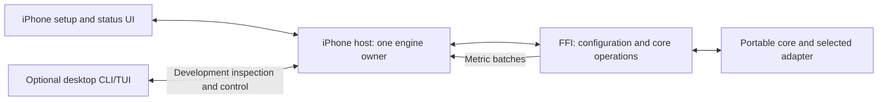

# Pheme VA iOS FFI Implementation Plan

## Status

Implementation started 2026-10-21; implementation status updated 2026-10-22.

The five implementation stages now have code in the worktree: iOS CI/packaging, the versioned configurable FFI, bounded live metrics, the Swift development host, and a paired desktop monitor. See the [native host guide](../../pheme-va/hosts/ios/README.md) for commands and ownership contracts.

Implementation does not mean deployment acceptance. Local validation is complete as recorded below. The first iOS CI run, simulator execution, and physical-device acceptance remain pending because the implementation machine has no full Xcode/iOS SDK. CPU Whisper is the packaging baseline. No background-service or device-performance claim is made.

Validation recorded on 2026-10-22:

| Check | Result |
| --- | --- |
| Rust formatting and workspace Clippy | Passed, including the final FFI run-correlation fix. |
| Full Rust workspace, one test thread | 305 passed, 6 intentionally ignored, 0 failed. |
| FFI without / with Whisper | 7 / 8 tests passed after the final fix, including ownership, live observation, busy/close, failure recovery, panic handling, and legacy ABI checks. |
| Local macOS Swift/C integration | Disabled, real Whisper, and isolated fake variants compiled, linked, and passed. These are not iOS simulator results. |
| Static host/tooling checks | Swift syntax, shell syntax, workflow/project YAML, documentation links, and diff whitespace checks passed. |
| iOS CI / simulator / physical iPhone | Pending; no workflow run or device installation has been performed. |

Reproduce the complete local Rust test pass with `GGML_NATIVE=OFF GGML_CPU_ARM_ARCH=armv8-a cargo test --workspace -- --test-threads=1` from `pheme-va/`. The CPU flags avoid an upstream Whisper native SVE probe that hung on this Mac. Earlier parallel workspace runs intermittently failed existing role-selection, downloader-cancellation, or Go-transport fixtures; the serial run retained all normally enabled tests. The new monitor's Darwin socket failure was fixed and its tests passed in both parallel and serial runs. This does not establish that the default parallel suite is reliable on this machine.

The local Swift link also emitted macOS deployment-target mismatch warnings from native dependencies; the resulting checks executed successfully. iOS compilation, linkage, and XCTest remain the responsibility of the new iOS workflow. No weights or generated build artifacts are included in the source changes.

## Objective and scope

Deliver a thin C ABI around Pheme's implemented portable core operations, configurable by an iPhone host, with metrics flowing out. The initial operational baseline is local Whisper transcription. Add an optional desktop CLI/TUI mode that monitors and configures the same engine instance running on the phone.

Agreed boundaries:

- FFI wraps the portable core and selected model adapters, exposes configuration and status, and emits metrics.
- Metrics ingestion is not required. Native measurements do not need to flow into FFI.
- The iPhone host owns saved settings, model provisioning, microphone capture, playback when needed, execution scheduling, and app lifecycle.
- Configuration and observability are bridge responsibilities; incident workflow rules remain in the portable Rust domain implementation as those capabilities are developed.
- The first iPhone deployment operates in the foreground. Continuous background execution needs separate platform requirements and acceptance.
- The optional desktop monitor uses the existing CLI executable and reuses TUI views where practical. The phone owns the active engine and computation.
- Complete conversational reasoning, incident confirmation/storage/retrieval, and replacement of the desktop reply subprocess are separate implementation work. They are not prerequisites for verifying this core bridge.
- Go remains the application-facing backend and benchmark owner. Native core execution and developer monitoring do not require moving Go onto the phone.

## Baseline before implementation

| Area | Current behaviour |
| --- | --- |
| Dependencies | FFI includes core and portable metrics with desktop features disabled; Whisper is optional. |
| Model loading | The Whisper constructor loads a model from a supplied path and reuses it. |
| Configuration | Model path at construction, dictionary setter, and metrics enable/disable are exposed. Other core settings are not exposed through C. |
| Operations | Transcription is synchronous and returns text through a Rust-owned C string. |
| Metrics | Events are grouped into JSON batches and drained through the Whisper handle. Resource sampling is disabled. |
| Correlation | Each transcription creates an internal run ID. The text result does not expose that ID; drained events do. |
| Concurrency | The current raw mutable handle has no safe concurrent-use contract for inference, inspection, or draining. |
| Retention | The current metrics batcher retains events until drained without an explicit capacity. |
| Packaging | An iOS Cargo command is documented, but there is no iOS packaging workflow or Swift integration test. |
| CLI/TUI | The TUI is already a CLI subcommand. It creates a local runtime; its Go Web-inspection mode does not attach to arbitrary FFI instances. |

Relevant existing sources:

- [FFI implementation](../../pheme-va/crates/ffi/src/lib.rs) and [C header](../../pheme-va/include/pheme_va.h)
- [Core engine configuration](../../pheme-va/crates/core/src/engine.rs)
- [Metrics batcher](../../pheme-va/crates/metrics/src/batch.rs) and [metrics contract](../api/metrics.md)
- [CLI entry point](../../pheme-va/crates/cli/src/main.rs) and [TUI startup](../../pheme-va/crates/cli/src/tui/mod.rs)
- [Existing Rust CI](../../.github/workflows/pheme-va-ci.yml)

## Intended ownership



The host drains metrics once and distributes batches to its local display, exporter, and optional remote monitor. Multiple displays must not compete to drain the same queue.

## Stage 1 — Establish an iOS CI verification gate

### Deliverables

Add a dedicated `.github/workflows/pheme-va-ios-ci.yml`, a reproducible packaging script under `pheme-va/scripts/`, and a minimal Swift integration test host under `pheme-va/hosts/ios/`.

Use an Apple Silicon macOS runner with Xcode for ARM64 simulator execution. Select and record compatible Rust/Xcode versions, the SDK, and the minimum iOS deployment target. Build only the FFI package and required dependencies for iOS; the desktop workspace binaries are not iOS build targets.

The pipeline should:

1. Build the actual Whisper-enabled FFI for `aarch64-apple-ios`.
2. Build the corresponding `aarch64-apple-ios-sim` variant.
3. Check the feature-disabled ABI separately, respecting which legacy symbols exist in that build.
4. Package the static libraries, C header, and module map into an XCFramework.
5. Link a minimal Swift host against the packaged artifact and required native frameworks.
6. Run simulator ABI smoke tests.
7. Upload the XCFramework and toolchain/build metadata as workflow artifacts.

A Cargo build alone is insufficient: the Swift link test must catch missing native libraries, frameworks, or exported symbols. Device compilation in CI does not require installation onto a signed physical device.

### Test levels

For every relevant pull request:

- Compile the real Whisper adapter.
- Exercise capability reporting, defined invalid-input/model-loading failures, and supported string-release behaviour from Swift.
- Use local fakes or a test-only harness for successful core operations and ownership tests without model weights. Test hooks must not appear in the production XCFramework.
- Extend the tests as configuration, structured results, and live metrics access land.

For an optional manually triggered job:

- Download a small model from a pinned source and verify its checksum.
- Run successful simulator transcription against an intentionally small speech fixture.
- Supply model/audio paths through configuration or environment variables.
- Keep weights, recordings collected during development, and generated artifacts out of Git.

CPU Whisper is the initial required baseline. Add Metal build/runtime checks separately before advertising acceleration support. Core ML validation can follow when required.

### Acceptance

CI establishes: **the bridge compiles for iOS, packages successfully, links into Swift, and passes simulator integration tests**.

Physical iPhone inference, microphone behaviour, device memory pressure, Metal behaviour, thermal behaviour, and performance remain Stage 4 acceptance. Simulator results do not establish those properties.

Use CI for this milestone. TestFlight distribution/CD can follow once the usable native app host exists.

## Stage 2 — Expose configuration, inspection, and safe lifecycle

### Files and API shape

Extend `pheme-va/crates/ffi/` and `pheme-va/include/pheme_va.h`. Split configuration, handle management, results, and tests into small modules where useful. Preserve existing exported signatures and document feature-specific availability.

Add a versioned API with these operations:

| Operation | Intended behaviour |
| --- | --- |
| Create | Allocate an unloaded bridge that can report capabilities and status. |
| Configure/load | Validate settings and initialize the selected core adapter. |
| Inspect | Return effective configuration, readiness, loaded model, active run, and last failure. |
| Transcribe | Return a structured result containing the run ID and core transcription result. |
| Update settings | Apply supported changes between operations. |
| Close/free | Stop admission and release resources after active work settles. |

Use bounded, versioned payloads for configuration/results and opaque handles at the C boundary. Distinguish compiled capabilities from model readiness.

Initially expose:

- Model selection/path resolved by the native host.
- Language and dictionary hints.
- Thread count.
- Maximum audio duration.
- Metrics enablement.

Apply thread settings consistently to the core decoder and Whisper adapter. Report effective settings so defaults or limits cannot silently misrepresent the configuration.

### Lifecycle and concurrency

Keep inference synchronous at the C boundary initially; the native host executes it away from the UI and audio callback.

Define idle/loading/running/unavailable/closing behaviour explicitly. Return a predictable busy response for overlapping inference or configuration changes. Model replacement requires idle state. Unloading before loading a replacement is acceptable to limit peak memory; failed replacement must report the actual unavailable state.

Replace whole-handle mutable access with shared handle access and synchronization around mutable engine state. Inspection must not wait behind a long-running inference lock. The metrics observer added in Stage 3 must likewise remain responsive.

The native wrapper owns handle lifetime. Destruction must not race outstanding calls. Cancelling a waiting UI task does not authorize releasing the model while inference continues.

Define ownership and deallocation, ABI/schema versions, stable errors, and feature availability. Check audio shape and size limits before copying buffers, initialize writable output pointers consistently, and contain recoverable Rust panics at the boundary. Raw-pointer validity remains part of the caller contract.

### Acceptance

Fake-backed tests cover invalid configuration, busy responses, failure recovery, feature-disabled behaviour, structured results, responsive inspection, and orderly teardown. Header/link checks verify compatibility with the documented ABI.

## Stage 3 — Provide safe live metrics output

### Deliverables

Preserve the existing `MetricEvent` and `MetricBatch` wire formats and their units, scope, provenance, sequence numbers, and unavailable-value semantics.

Introduce an independent thread-safe observer handle that can drain metrics while the engine is running. Define observer lifetime and release separately from engine mutation; no observer call may race destruction of that observer handle.

Add bounded retention for the FFI consumer, with explicit dropped-event counts in observer status. Introduce limits in `metrics` or a small FFI subscriber without silently changing existing server/exporter behaviour. Metric publication must remain lightweight and must not perform network I/O.

The native host is the single drain owner and distributes the same batches to consumers. If an exporter retries a batch, retain its existing identity and content. Remote monitoring must not re-drain or rebatch events for upload.

### Run IDs and experiment IDs

A run ID identifies one admitted operation. An experiment ID associates operations with a benchmark experiment.

Keep generated run IDs as the default:

- Return the run ID alongside the structured result.
- Expose it in the active-run snapshot.
- Preserve it in failure information after admission.
- Use the same ID for the operation's outgoing metrics.

An experiment ID is optional for standalone use. The Go metrics endpoint can associate a batch with the experiment in its URL. Accepting caller-provided IDs can be added when a concrete benchmark requirement needs it; accepting measurements into FFI is not part of this plan.

Current FFI output covers internally collected timings, statuses, and model metadata. iPhone CPU, RAM, battery, and other platform observations remain host responsibilities. Unmeasured values must not be shown as zero or inferred power.

### Acceptance

Use a controlled blocking fake to verify that metrics can be published and drained during inference. Verify result/event correlation, output ownership, collection enablement for future operations, visible overflow, unchanged batch schema, and repeated drains returning only newly retained events.

## Stage 4 — Implement the usable iPhone host and device acceptance

### Deliverables

Expand the Swift test host into a small development app with a `PhemeService` wrapper under `pheme-va/hosts/ios/`.

The wrapper owns one engine, its observer, and a dedicated execution path for blocking model/inference work. Collect status and metrics independently of that blocked executor. Distribute updates to the main-thread UI.

Startup follows:

```text
Read saved configuration
          |
Validate settings and provisioned model availability
          |
          +-- valid --> load --> ready
          |
          +-- missing/invalid --> setup --> configure --> load
```

Persist successfully applied configuration in app-owned storage. Resolve models from files provisioned on the phone; a desktop filesystem path is not a phone model path. Keep a recoverable setup state if files disappear or loading fails.

The native interface includes:

- Setup/model selection and supported settings.
- Effective configuration and engine status.
- Push-to-talk transcription and result display.
- Active-run and metric views.

Capture audio with native APIs and convert buffers explicitly to the FFI interleaved `f32` contract. Handle microphone permission, audio interruptions, route changes, app transitions, and memory warnings.

Initial cancellation discards the unwanted result while retaining resources until native work settles. Cooperative adapter cancellation can follow when supported and tested.

### Physical-device acceptance

On a selected iPhone, verify:

- Fresh setup and saved-settings restoration.
- Local transcription with a provisioned model and network inference disabled.
- Repeated microphone turns and responsive UI/metrics.
- Interruption and recovery without use-after-free or unintended model reload.
- Missing/corrupt model recovery and safe model switching.
- Actual accelerator use or CPU fallback when acceleration is enabled.
- Cold/warm latency, peak memory, and sustained thermal behaviour.

Record device, OS, model checksum, runtime/build configuration, and measurement availability. Energy or endurance claims require an appropriate measurement method.

This stage establishes the native core host. Additional speech synthesis, conversational reasoning, and incident workflow capabilities should be accepted separately as implemented.

## Stage 5 — Optional desktop CLI/TUI monitor

### Deliverables

Add a dedicated remote-monitor mode to the existing CLI executable. Branch before current local TUI startup initializes models, workers, microphone resources, or the reply subprocess.

For the initial transport, use an explicitly enabled, paired development WebSocket connection hosted by the desktop CLI. The iPhone app connects outward. Keep transport and connection management in the hosts, outside FFI and the portable core. Start with one paired desktop controller.

Define a small versioned command/event contract:

| Command or event | Behaviour |
| --- | --- |
| Inspect | Capabilities, readiness, active run, and effective configuration. |
| Observe | Existing metric batches and connection cursor/drop information. |
| Configure | Validate and apply settings through the phone's `PhemeService`. |
| Select model | Select an already-provisioned phone model when idle. |
| Acknowledge | Identify the command and report applied configuration or rejection. |
| Disconnect/reconnect | Preserve phone execution; resume observation or report a retention gap. |

Do not replay configuration/model changes automatically after reconnect. Refresh the authoritative phone snapshot first.

Reuse telemetry rendering from `crates/cli/src/tui/telemetry.rs` where practical. Add a remote client and remote startup path without changing the established local TUI or Go Web-inspection semantics.

Show the connected device, effective settings, active operation, and collection/connection failures. Remote configuration must work when the phone has no saved configuration but already has a selectable model artifact. Downloading models remotely is not required for this first monitor.

### Acceptance

A desktop with no local weights can attach, inspect phone metrics, configure an initially unconfigured phone, and change an allowed setting. Opening the monitor must not initialize a second local model. Disconnecting it must leave phone processing intact.

Fake-host tests cover malformed messages, rejected/busy configuration, dropped connections, reconnects, explicit acknowledgements, and bounded telemetry.

## Validation and documentation throughout implementation

| Layer | Checks |
| --- | --- |
| Rust | `cargo fmt --all -- --check`, `cargo clippy --workspace --all-targets -- -D warnings`, and `cargo test --workspace` from `pheme-va/`. |
| FFI features | Explicit feature-disabled and Whisper-enabled compile/link checks; accelerator checks when supported. |
| C/Swift boundary | Header import, native linking, returned data ownership, error handling, and lifecycle tests. |
| Concurrency | Controlled fake inference with simultaneous inspection/draining and orderly shutdown. |
| iOS | Device/simulator compilation in CI, simulator integration tests, later physical-device acceptance. |
| Remote monitoring | Deterministic fake-host tests and a phone-to-desktop integration scenario. |

Update the [Pheme README](../../pheme-va/README.md), [metrics guide](../api/metrics.md), [architecture](../architecture.md), [roadmap](../roadmap.md), and repository implementation-state notes as capabilities land. Keep detailed design here and put reproducible native setup instructions beside the host.

## Delivery order and completion gates

| Stage | Gate | Physical iPhone required? |
| --- | --- | --- |
| 1. CI verification | iOS build, XCFramework packaging, Swift linking, simulator smoke tests pass. | No |
| 2. Configurable bridge | Configuration, inspection, ABI, and lifecycle tests pass. | No |
| 3. Live metrics | Safe bounded draining and run correlation pass deterministic tests. | No |
| 4. Native host | Saved setup, microphone operation, recovery, and device inference pass. | Yes |
| 5. Optional monitor | The desktop controls and observes the same phone engine without owning inference. | For final acceptance |

Stages 1–3 establish a verified library integration boundary. Stage 4 establishes the usable iPhone core host. Stage 5 adds the monitoring/configuration bonus. Hosted CI alone does not establish physical-device performance or continuous background execution.
