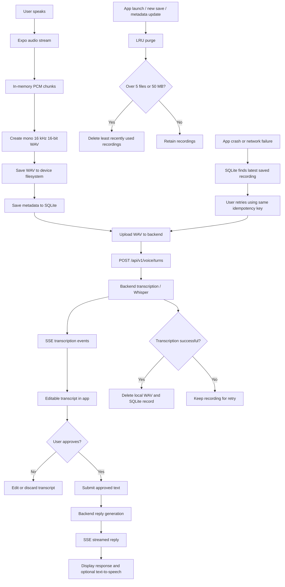
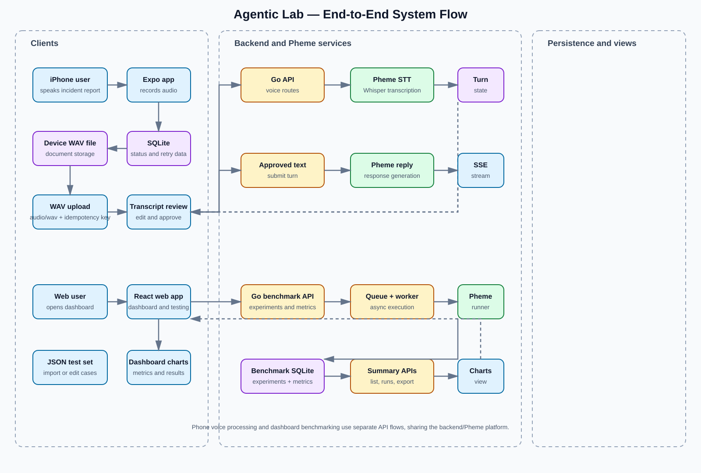
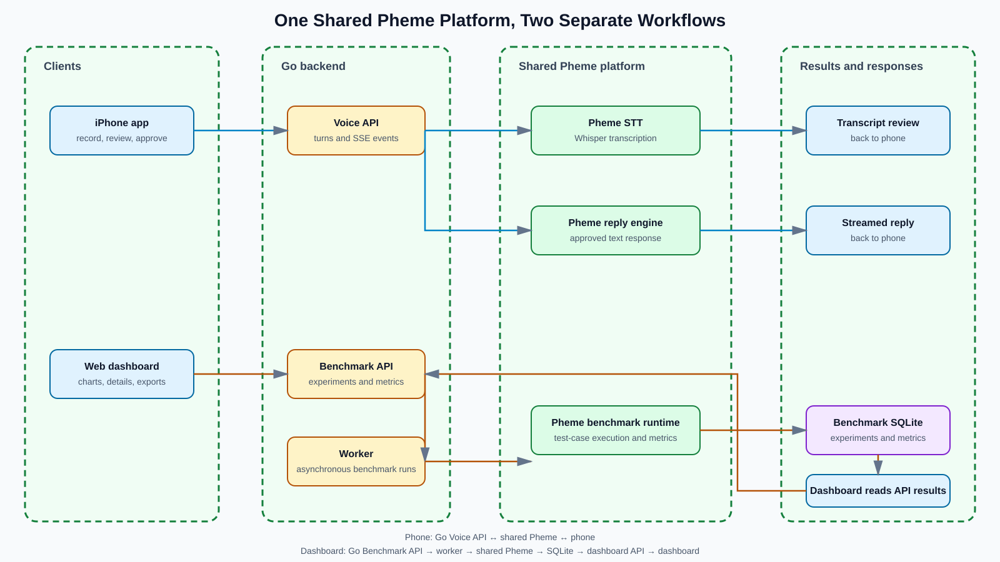
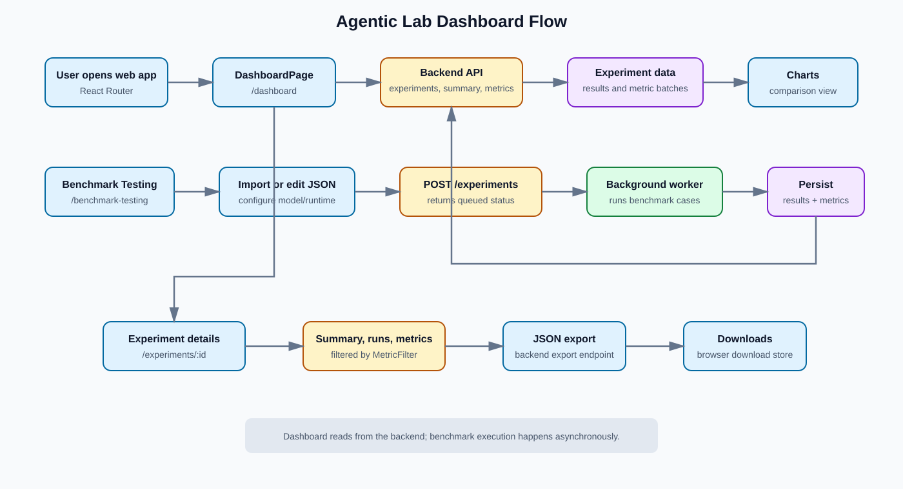

# Voice Recording Architecture

The iOS app uses a local-first voice workflow. Audio is temporarily captured in memory, persisted to the device before upload, and then sent to the backend for transcription and reply generation.

## Architecture diagram



## Recording and audio format

The app uses `expo-audio` to capture:

- Mono audio
- 16 kHz sample rate
- 16-bit PCM samples

Audio buffers are temporarily held in memory while recording. When the user stops recording, the buffers are assembled into a WAV file.

## Local device storage

The WAV file is saved under the app's document storage:

```text
voice-recordings/<recording-id>.wav
```

SQLite stores the recording metadata:

- Recording ID
- File URI
- File size
- Duration
- Creation time
- Last-used time
- Upload status
- Idempotency key
- Backend turn ID
- Error message, if applicable

The audio bytes are not stored inside SQLite. SQLite stores metadata only.

The storage relationship is:

```text
SQLite database
└── recording metadata
    ├── file URI
    ├── status
    ├── timestamps
    ├── retry/idempotency key
    └── backend turn ID

Device filesystem
└── voice-recordings/
    ├── recording-001.wav
    ├── recording-002.wav
    └── ...
```

## SQLite initialization and migration

The app opens `voice-recordings.db` and creates the `recordings` table if it does not already exist.

Older JSON manifest data is migrated into SQLite once so that existing locally saved recordings are not discarded.

## Upload and backend processing

The saved WAV file is sent to:

```text
POST /api/v1/voice/turns
```

The request includes:

- `Content-Type: audio/wav`
- `Accept: text/event-stream`
- A stable `Idempotency-Key`

The stable key prevents a retry from creating a duplicate backend turn.

The backend processes the WAV and streams status events back to the app, including:

- `turn.created`
- `transcript.ready`
- `turn.failed`
- `question.approved`
- `reply.started`
- `reply.delta`
- `reply.completed`

The transcript is shown to the user for review before it is submitted for reply generation.

## Crash and retry behavior

If the app crashes after the WAV has been saved, the file and SQLite metadata remain on the device.

On the next launch:

1. The app reads the latest recording from SQLite.
2. The user can retry the saved recording.
3. The same idempotency key is reused.
4. The backend can identify it as the same request.

## LRU purging policy

The app enforces:

- Maximum 5 recordings
- Maximum 50 MB total local audio

When either limit is exceeded, the least recently used recordings are deleted first based on `updatedAt`.

Successfully transcribed recordings are deleted immediately.

Purging is triggered:

- When the app starts
- After saving a new recording
- After recording metadata changes

There is no cron job or background cleanup task.

## Current limitation

Although SQLite can retain multiple recordings, the current UI selects and retries only the most recently updated recording. There is not yet a recording history screen for choosing older saved recordings individually.

The backend processes the uploaded audio but does not add a separate long-term raw-audio archive.

## Dashboard architecture







The web dashboard is a separate frontend flow for creating, monitoring, comparing, inspecting, and exporting benchmark experiments.

```mermaid
flowchart TD
    A[User opens web app] --> B[React Router]
    B --> C[/dashboard]

    C --> D[DashboardPage loads]
    D --> E[GET /api/v1/experiments]
    D --> F[GET /api/v1/experiments/:id/summary]
    D --> G[GET /api/v1/experiments/:id/metrics]

    E --> H[Experiment list]
    F --> I[Status, run count, result summary]
    G --> J[Metric batches]

    H --> K[ComparisonCharts]
    J --> K
    K --> L[Cross-experiment charts]
    H --> M[Latest experiment panel]
    I --> M
    J --> M

    M --> N[/experiments/:id]
    N --> O[ExperimentDetailsPage]
    O --> P[GET experiment details]
    O --> Q[GET summary, runs, and metrics]
    O --> R[MetricFilter]
    R --> S[Filtered metric cards and timeline]

    C --> T[Refresh]
    T --> D
    C --> U[JSON export]
    U --> V[GET /experiments/:id/export]
    V --> W[DownloadStore]
    W --> X[/downloads]

    Y[/benchmark-testing] --> Z[Import or edit JSON test set]
    Z --> AA[Configure model, quantization, runtime, profile]
    AA --> AB[POST /api/v1/experiments]
    AB --> AC[Backend queues experiment]
    AC --> AD[Background benchmark worker]
    AD --> AE[Run configured cases through Pheme]
    AE --> AF[Persist experiment results and metric batches]
    AF --> D
```

### Dashboard flow

1. The user enters `/dashboard`, which loads the experiment list.
2. The dashboard selects the requested experiment, or defaults to the first available experiment.
3. The frontend requests the selected experiment’s summary and metric batches in parallel.
4. The dashboard renders comparison charts, status, model information, run counts, and metric-batch counts.
5. Selecting an experiment opens `/experiments/:id`, where detailed metrics, runs, filters, timelines, and raw data are displayed.
6. JSON export requests the backend export endpoint and stores the downloaded result in the browser’s download store.
7. The Download Manager displays previously generated browser downloads.

### Starting a benchmark experiment

The Benchmark Testing page accepts an imported or edited JSON test set. The user configures the model, quantization, runtime, and environment profile. The frontend submits the experiment asynchronously to `POST /api/v1/experiments`.

The backend stores the experiment as queued, runs it through a background worker, persists the result and metric batches, and makes the data available to the dashboard on refresh.

The dashboard does not execute benchmark cases directly. It reads experiment and metric data from the backend API.
